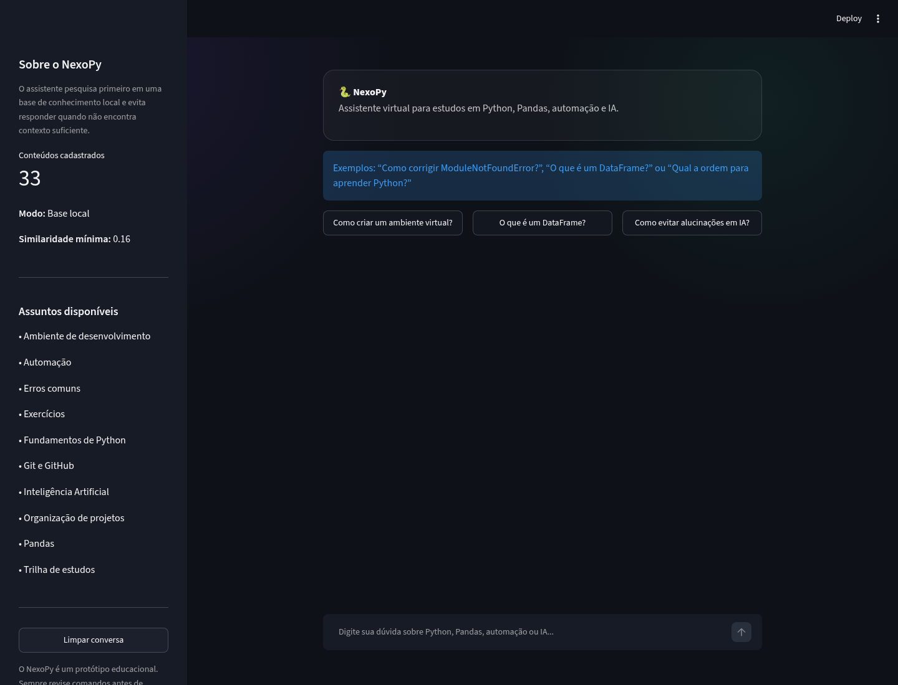
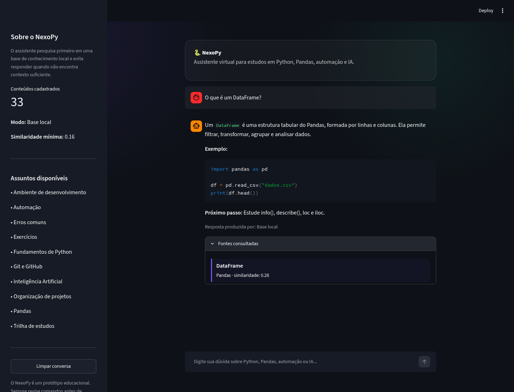
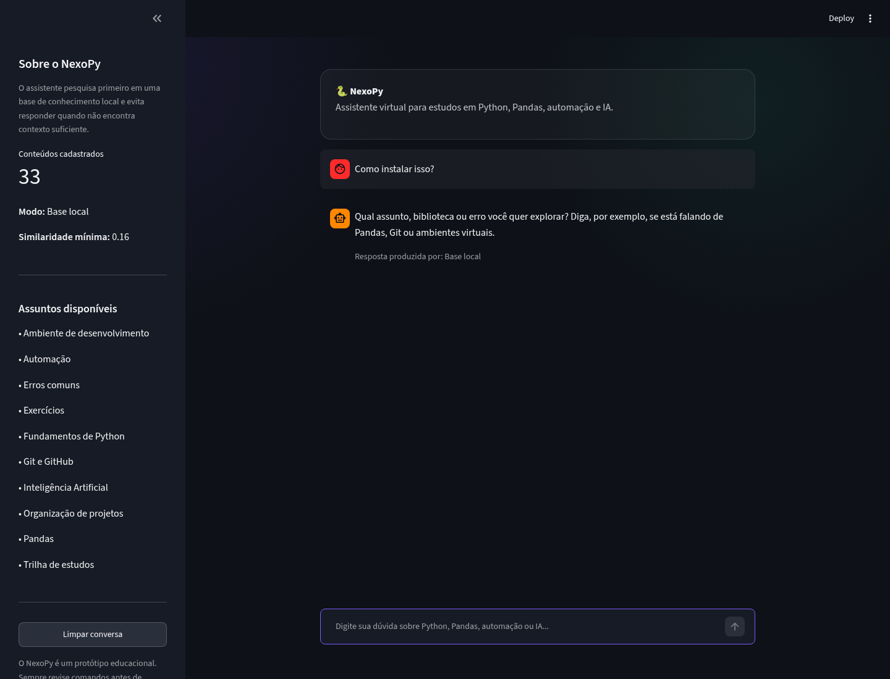
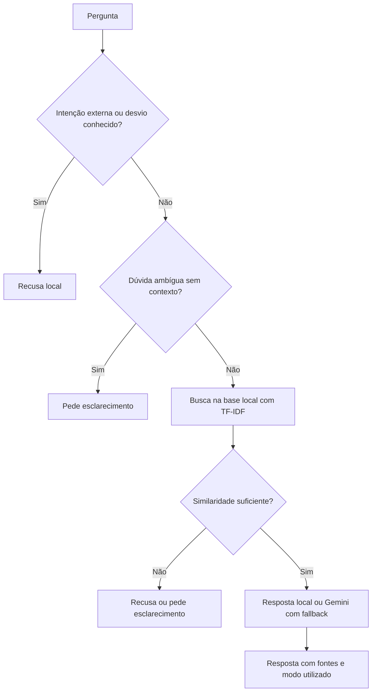

# 🐍 NexoPy

**Assistente virtual para estudos em Python, Pandas e automação.**

[](https://github.com/sonmook/nexopy-assistente-virtual/actions/workflows/tests.yml)

O NexoPy ajuda iniciantes a estudar programação com explicações, exemplos e fontes
consultadas. Funciona com uma base local de **33 conteúdos**, sem chave de API, e
oferece integração opcional com **Gemini** para gerar respostas a partir do contexto
recuperado.

Projeto educacional desenvolvido para o desafio **Construa Seu Assistente Virtual
Com Inteligência Artificial**, da DIO.

## O sistema em imagens

Capturas reais da aplicação em execução no **modo local**, usando perguntas de
demonstração.

### Tela inicial

Chat com sugestões de perguntas, assuntos disponíveis e indicação do modo de execução.



### Resposta com exemplo e fontes

O assistente apresenta uma explicação, um exemplo de código, um próximo passo e as
fontes recuperadas. Cada resposta informa se foi produzida pela base local ou pelo Gemini.



### Esclarecimento de perguntas ambíguas

Quando falta contexto, o NexoPy pede mais detalhes antes de selecionar um assunto.



## Recursos

- Chat em Streamlit com histórico e opção de limpar a conversa.
- Conteúdos sobre Python, Pandas, automação, Git, erros comuns e fundamentos de IA.
- Recuperação com TF-IDF e similaridade de cosseno, com fontes exibidas na interface.
- Modo local sem API e integração opcional com Gemini.
- Fallback para a base local quando a chamada generativa falha ou não é concluída.
- Pedidos de esclarecimento para dúvidas genéricas sem contexto utilizável.
- Continuação de perguntas como “Pode explicar melhor?” a partir do assunto anterior do usuário.
- Regras conservadoras para recusar pedidos conhecidos fora do escopo e instruções adversas.
- Feedback por resposta com “Ajudou”, “Não ajudou” e comentário opcional.
- Avaliação reproduzível e testes automatizados no GitHub Actions.

## Como funciona



## Requisitos

- **Python 3.11 ou superior**; desenvolvimento e CI validados com Python 3.12.
- Git para clonar o repositório.
- Chave da API Gemini somente para o modo generativo.

## Instalação

```bash
git clone https://github.com/sonmook/nexopy-assistente-virtual.git
cd nexopy-assistente-virtual
python -m venv .venv
```

Ative o ambiente virtual conforme o seu sistema:

**Windows — PowerShell**

```powershell
.\.venv\Scripts\Activate.ps1
```

**Linux / macOS**

```bash
source .venv/bin/activate
```

Instale as dependências e inicie a aplicação:

```bash
python -m pip install -r requirements.txt
python -m streamlit run app.py
```

O Streamlit informa no terminal o endereço para abrir no navegador. O modo local é
o padrão e **não precisa de arquivo `.env` nem de chave de API**.

## Ativar o Gemini

1. Copie `.env.example` para `.env`.
2. Preencha `GEMINI_API_KEY` com sua chave, apenas no arquivo local.
3. Defina `USE_GEMINI=true` e reinicie a aplicação.

```env
USE_GEMINI=true
GEMINI_API_KEY=sua_chave_aqui
GEMINI_MODEL=gemini-3.5-flash
```

Em ambientes gerenciados, use a configuração segura de segredos para
`GEMINI_API_KEY` e uma variável `USE_GEMINI=true`, em vez de gravar a chave em arquivo.
Nunca envie chaves ou o arquivo `.env` ao GitHub.

A integração usa **`google-genai>=2.34,<3.0`** e o formato atual da API Interactions.
Se já tinha o projeto instalado, atualize as dependências com
`python -m pip install -r requirements.txt`: o esquema do SDK 1.x não é mais aceito
pela API. A chamada tem um limite de 45 segundos; falhas acionam uma resposta local
com aviso. O acesso ao modelo depende da disponibilidade e das permissões da sua conta.

## Testes e avaliação

Instale as ferramentas de desenvolvimento e execute:

```bash
python -m pip install -r requirements-dev.txt
python -m pytest -q
python scripts/evaluate.py
ruff check --isolated --select E9,F .
```

A validação local mais recente passou com **93 testes** e **38/38 casos conformes**.
A avaliação roda no modo local, sem chamadas externas:

| Grupo | Casos conformes |
| --- | ---: |
| Casos originais | 20/20 |
| Paráfrases | 6/6 |
| Perguntas ambíguas | 3/3 |
| Continuação com histórico | 3/3 |
| Pedidos fora do escopo com vocabulário de Python | 3/3 |
| Instruções adversas | 3/3 |

São verificados a ação esperada (responder, recusar ou esclarecer), a fonte
principal, a existência das fontes e os termos esperados no conteúdo. Os resultados
são gerados em `outputs/avaliacao_detalhada.csv` e `outputs/metricas.json`.

Os casos orientaram os ajustes do sistema e servem para detectar regressões.
**100% nesse conjunto não comprova segurança geral, ausência de alucinações nem
qualidade em perguntas inéditas.** Os testes do Gemini simulam o contrato do SDK;
a integração também foi validada manualmente com uma chamada real, mas essa chamada
não faz parte do CI.

O GitHub Actions executa testes, análise estática e avaliação. A avaliação retorna
erro se a assertividade ficar abaixo de 85%, a conformidade abaixo de 95% ou algum
caso obrigatório de recusa ou esclarecimento falhar. Veja os critérios e as
limitações em [Avaliação e métricas](docs/04-metricas.md).

### Diagnóstico com perguntas novas

Um segundo conjunto sintético, escrito separadamente dos casos usados nos ajustes,
obteve **9/18 casos conformes (50%)** na primeira medição. Após corrigir os achados
da auditoria, o resultado passou a **15/18 (83,33%)**: ambiguidades, continuações,
pedidos externos e desvios testados passaram; três paráfrases ainda falham na busca.
Como esses casos já orientaram correções, agora são uma referência conhecida,
e uma nova medição independente exigirá outro conjunto de perguntas.

```bash
python scripts/evaluate.py --cases tests/casos_independentes_v1.json --output-dir outputs/independente-v1 --report-only
```

O CI disponibiliza esse diagnóstico como artefato separado, sem aplicar os limiares
de aprovação da regressão. Consulte as falhas e a metodologia no
[diagnóstico independente](docs/06-diagnostico-independente.md).

## Feedback das respostas

Abra **“Esta resposta ajudou?”** e selecione **“👍 Ajudou”** ou **“👎 Não ajudou”**.
Você pode incluir um comentário de até **500 caracteres** antes de enviar. Cada
resposta aceita uma avaliação; reenvios não duplicam o registro. Uma confirmação
aparece após a gravação, e falhas permitem tentar novamente.

O registro contém voto, comentário, fontes, modo, ação e horário do envio, sem
copiar a pergunta ou a resposta.
Não inclua dados pessoais ou credenciais no comentário.

Os registros ficam em `outputs/feedback.sqlite3`, ignorado pelo Git. O armazenamento
é local à instância e pode ser perdido se o disco não for preservado. Para configurar
o caminho, defina `NEXOPY_FEEDBACK_PATH` antes de iniciar o Streamlit. Limpar a
conversa não apaga os votos enviados. Não há envio a serviços externos nem análise
automática dos comentários. Veja os detalhes em [Feedback](docs/07-feedback.md).

## Estrutura do projeto

```text
nexopy-assistente-virtual/
├── .github/workflows/tests.yml   # Validação contínua
├── .streamlit/config.toml        # Tema da interface
├── assets/screenshots/           # Capturas reais do sistema
├── data/conhecimentos.json       # Base educacional
├── docs/                        # Documentação do desafio
├── outputs/                     # Resultados locais da avaliação
├── scripts/evaluate.py           # Avaliação com critérios mínimos
├── src/nexopy/                   # Busca, assistente, prompts e integração Gemini
├── tests/                        # Testes e casos de avaliação
├── app.py                        # Chat Streamlit
├── .env.example                  # Exemplo sem credenciais
├── pyproject.toml
├── requirements.txt
└── requirements-dev.txt
```

## Cuidados e limitações

- A base cobre assuntos introdutórios; respostas precisam de revisão humana.
- Similaridade textual pode selecionar um assunto inadequado ou deixar de reconhecer uma pergunta.
- Regras de recusa são heurísticas para intenções conhecidas, sem proteção completa contra prompt injection.
- A classificação distingue operações de programação sobre dados de pedidos externos explícitos; dúvidas fora dos padrões conhecidos ainda podem falhar.
- `MIN_SIMILARITY` deve ser finito e estar no intervalo `(0, 1]`; `TOP_K` deve ser inteiro positivo. Resultados com similaridade zero ou inválida nunca são usados.
- No modo local, pedir outro exemplo reapresenta o exemplo disponível na base.
- As fontes exibidas são os conteúdos recuperados; sua presença não comprova que toda resposta generativa esteja fundamentada.
- As chaves ficam fora do repositório; mensagens de falha do provedor não são exibidas com seus detalhes internos.
- O modo generativo depende da API e pode gerar custos conforme o serviço utilizado.

## Documentação do desafio

1. [Documentação do agente](docs/01-documentacao-agente.md)
2. [Base de conhecimento](docs/02-base-conhecimento.md)
3. [Prompts](docs/03-prompts.md)
4. Aplicação funcional em [`app.py`](app.py)
5. [Avaliação e métricas](docs/04-metricas.md)
6. [Pitch](docs/05-pitch.md)

## Próximas evoluções

- Usar o diagnóstico independente para priorizar correções e reservar novas perguntas para a próxima medição.
- Ampliar conteúdos, exercícios e níveis de dificuldade.
- Analisar o feedback recebido e definir armazenamento persistente para uma demonstração pública.
- Adicionar acompanhamento do progresso do estudante.
- Comparar TF-IDF com embeddings usando os mesmos critérios.
- Publicar uma demonstração no Streamlit Community Cloud.

## Autor e licença

Desenvolvido por **Emerson**, para fins educacionais e de portfólio.
Distribuído sob a [licença MIT](LICENSE).
