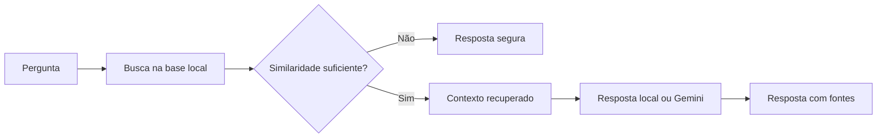

# 🐍 NexoPy

**Assistente Virtual para Estudos em Python e Automação**

O NexoPy é um protótipo de assistente educacional criado para o desafio
**Construa Seu Assistente Virtual Com Inteligência Artificial**, da DIO.

Ele ajuda pessoas iniciantes a entender conceitos de Python, Pandas, automação,
Git, erros comuns e fundamentos de inteligência artificial.

## Objetivo

O projeto demonstra como combinar:

- uma base de conhecimento organizada;
- recuperação de informações com TF-IDF;
- similaridade de cosseno;
- uma interface de chat em Streamlit;
- uma IA generativa opcional;
- regras para reduzir respostas inventadas;
- avaliação com métricas reproduzíveis.

## Principais recursos

- Chat interativo;
- Mais de 30 conteúdos educacionais;
- Busca por similaridade;
- Fontes exibidas em cada resposta;
- Recusa segura para perguntas fora do escopo;
- Modo local sem necessidade de API;
- Integração opcional com Gemini;
- Histórico de conversa;
- Avaliação automatizada;
- Testes com Pytest;
- Workflow de testes no GitHub Actions.

## Como funciona



## Estrutura

```text
nexopy-assistente-virtual/
├── .github/workflows/tests.yml
├── .streamlit/config.toml
├── assets/
├── data/
│   └── conhecimentos.json
├── docs/
│   ├── 01-documentacao-agente.md
│   ├── 02-base-conhecimento.md
│   ├── 03-prompts.md
│   ├── 04-metricas.md
│   └── 05-pitch.md
├── outputs/
├── scripts/
│   └── evaluate.py
├── src/nexopy/
│   ├── assistant.py
│   ├── config.py
│   ├── evaluation.py
│   ├── knowledge.py
│   ├── llm.py
│   └── prompts.py
├── tests/
│   ├── casos_avaliacao.json
│   └── test_assistant.py
├── app.py
├── .env.example
├── .gitignore
├── LICENSE
├── pyproject.toml
├── requirements-dev.txt
└── requirements.txt
```

## Requisitos

- Python 3.11 ou superior;
- Git, opcional para versionamento;
- Chave do Gemini apenas para o modo generativo.

## Instalação no Windows

```powershell
python -m venv .venv
.\.venv\Scripts\Activate.ps1
python -m pip install --upgrade pip
python -m pip install -r requirements.txt
```

## Executar

```powershell
streamlit run app.py
```

O navegador abrirá a aplicação localmente.

## Modo local

O modo local funciona sem chave de API. Ele pesquisa a base, seleciona a fonte
mais relevante e monta a resposta com explicação, exemplo e próximo passo.

O arquivo `.env` não é necessário nesse modo.

## Ativar o Gemini

1. Copie `.env.example` para `.env`;
2. Preencha sua chave;
3. Altere `USE_GEMINI` para `true`.

```env
USE_GEMINI=true
GEMINI_API_KEY=sua_chave_aqui
GEMINI_MODEL=gemini-3.5-flash
```

Nunca envie o arquivo `.env` para o GitHub.

## Executar avaliação

```powershell
python scripts/evaluate.py
```

Serão gerados:

```text
outputs/avaliacao_detalhada.csv
outputs/metricas.json
```

## Resultado da avaliação inicial

A versão inicial alcançou **100% de assertividade de recuperação** e **100% de respostas seguras** nos 20 casos documentados. Os resultados podem ser reproduzidos com o script de avaliação.

## Executar testes

```powershell
python -m pip install -r requirements-dev.txt
pytest -q
```

## Os 6 passos do desafio

1. [Documentação do agente](docs/01-documentacao-agente.md)
2. [Base de conhecimento](docs/02-base-conhecimento.md)
3. [Prompts do agente](docs/03-prompts.md)
4. Aplicação funcional em `app.py`
5. [Avaliação e métricas](docs/04-metricas.md)
6. [Pitch](docs/05-pitch.md)

## Segurança

- A resposta depende de uma fonte recuperada;
- Perguntas fora do escopo são recusadas;
- O prompt proíbe conteúdo inventado;
- A chave da API fica fora do repositório;
- A aplicação continua funcionando quando a API falha;
- As fontes são exibidas para permitir verificação.

## Limitações

- A base cobre assuntos introdutórios;
- Similaridade textual não entende todos os contextos;
- O modo generativo depende da disponibilidade da API;
- O NexoPy não substitui documentação oficial ou revisão humana.

## Próximas evoluções

- Adicionar mais conteúdos e exercícios;
- Criar níveis de dificuldade;
- Salvar progresso do estudante;
- Adicionar feedback positivo e negativo;
- Comparar TF-IDF com embeddings;
- Publicar no Streamlit Community Cloud.

## Autor

Projeto desenvolvido por **Emerson** para fins educacionais e de portfólio.

## Licença

Distribuído sob a licença MIT.
