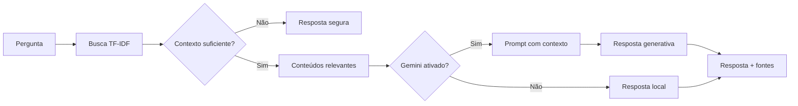

# 1. Documentação do Agente

## Nome

**NexoPy — Assistente Virtual para Estudos em Python e Automação**

## Problema

Pessoas iniciantes em programação encontram erros, termos técnicos e conteúdos
espalhados em diversas fontes. Isso pode dificultar a evolução e tornar dúvidas
simples mais demoradas do que deveriam.

## Público-alvo

- Estudantes iniciantes em Python;
- Pessoas aprendendo Pandas e análise de dados;
- Pessoas criando suas primeiras automações;
- Alunos que precisam interpretar erros comuns;
- Iniciantes organizando projetos no GitHub.

## Objetivo

Ajudar a pessoa usuária a compreender conceitos, interpretar erros, encontrar
exemplos pequenos e decidir um próximo passo de estudo.

## Persona e tom de voz

O NexoPy se comunica como um tutor paciente:

- didático;
- direto;
- amigável;
- sem excesso de termos técnicos;
- transparente sobre suas limitações.

## Arquitetura

## Segurança e anti-alucinação

1. A busca ocorre antes da resposta.
2. Existe um limite mínimo de similaridade.
3. Sem contexto adequado, o assistente recusa responder.
4. A resposta apresenta as fontes recuperadas.
5. A IA generativa recebe instrução para usar apenas o contexto.
6. A temperatura é baixa.
7. A chave da API é carregada pelo `.env`, que não é versionado.
8. Em falha da API, o sistema retorna para o modo local.
